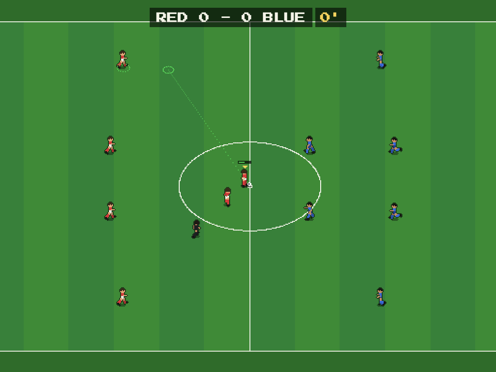
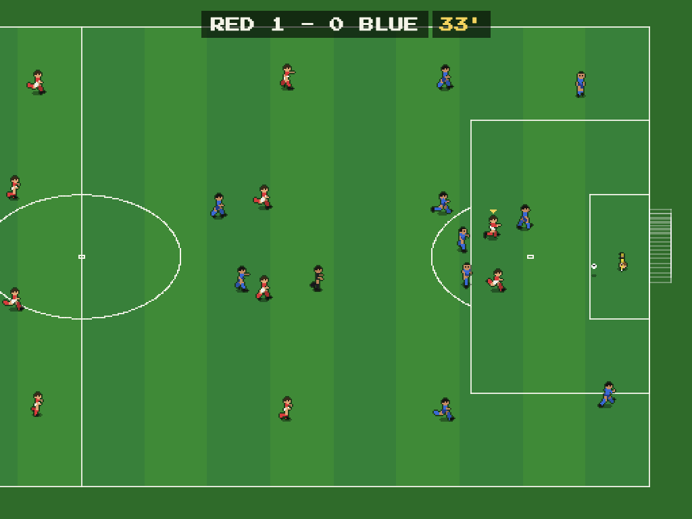
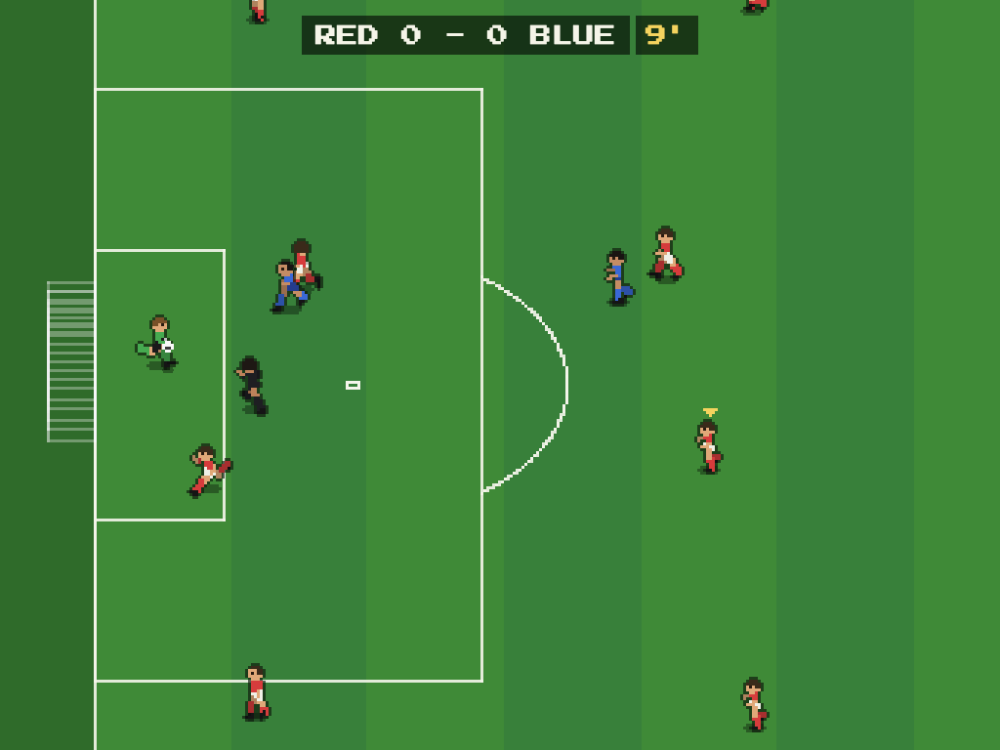
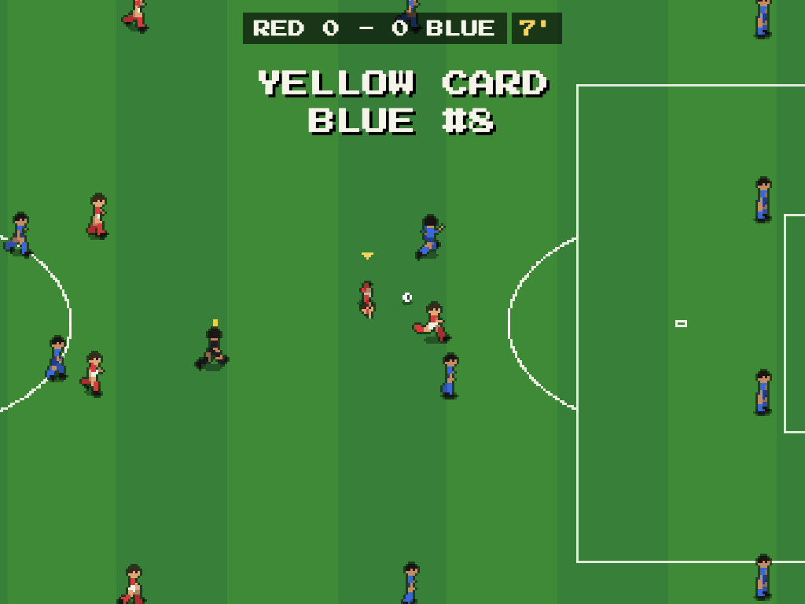
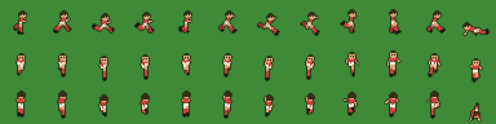

# Pixel Pitch

Browser football game: FIFA-style gameplay, pixel-art look. Red (you) vs Blue (CPU), 11 v 11.



| | |
|---|---|
|  |  |
| Attack on goal: the keeper narrows the angle and dives | Close camera: the keeper claims the ball under pressure |
|  |  |
| Fouls are judged by severity: the referee shows the card | Sprites are generated from a 3D skeleton: sprint, kick, tackle, slide in 16 directions |

## Features

- 11 v 11 in a 4-4-2, team AI that presses, covers, keeps shape, passes and shoots
- Ball physics in 3D: height, air drag, bounces, rolling friction, posts and crossbar
- Charged passes, shots and lobs, pass assist towards the teammate you aim at, fake shots
- Aim guide showing the predicted path and landing spot, sized by the kick's inaccuracy
- Standing and slide tackles, fouls judged by severity, yellow and red cards, free kicks and penalties
- Corners, goal kicks, throw-ins and kickoffs for both sides, with a referee following play
- Training mode (you against the keeper), match clock, three difficulty levels
- Deterministic simulation: same seed and inputs, same match

## Run

```bash
npm install
npm run dev      # http://localhost:5180
npm test         # simulation tests (physics, rules, AI soak test)
npm run build    # typecheck + production bundle in dist/
```

`sprites.html` (dev server only) shows every generated sprite frame: `/sprites.html?kit=home&poses=jog,sprint&dirs=0,4,8,12`.

## Controls

| Action | Keyboard | Gamepad |
|---|---|---|
| Move | Arrows | Left stick |
| Sprint | Shift | RT |
| Pass / standing tackle | S | A |
| Shoot / slide tackle | D | B |
| Lob | A | X |
| Switch player | Q | LB |
| Pause | Esc | |

Hold a kick button to charge, release to kick. Press another kick button while charging to fake.
Passes and lobs snap to the teammate in the stick direction; control follows the pass.

## How it's built

- `src/sim`: the game itself, plain TypeScript with no Phaser imports. Fixed 60 Hz tick, seeded RNG, so a match is reproducible from (seed, inputs). Keep `Math.random` and wall-clock time out of here.
  - `ball.ts` 3D ball (height, air drag, bounces, rolling friction)
  - `player.ts` movement, possession, human input; `kick.ts` kick model, pass assist, aim preview
  - `ai.ts` team AI (press, cover, shape, passing, dribbling, shooting); `keeper.ts` goalkeepers
  - `tackle.ts` tackles, fouls, cards; `match.ts` rules, restarts, set pieces, clock; `referee.ts`
- `src/render`: Phaser 4 renderer. Sprites are generated at startup from a small 3D skeleton (`figure.ts`), 16 facing directions. Integer zoom, sub-pixel positions, interpolation between sim ticks.
- `src/ui`: DOM menus and settings (saved in localStorage). `src/audio`: synthesized sound effects.

## Not done yet

Offside, halves and side switching, substitutions, curve/spin on the ball, a recorded crowd sound, gamepad navigation in menus.
